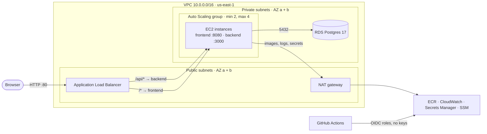

# TaskFlow

A small task tracker (static frontend + Node/Express API + Postgres) that runs on AWS behind a load
balancer, across two Availability Zones, and reaches production only through a 12-stage DevSecOps pipeline.
The app is deliberately tiny: the project is the delivery, security and operations around it.

| What | Link |
|------|------|
| **Live app** | http://taskflow-alb-466982077.us-east-1.elb.amazonaws.com |
| Health (deployed version) | http://taskflow-alb-466982077.us-east-1.elb.amazonaws.com/api/health |
| GitHub repo | https://github.com/hussainwaz/taskflow-devops |
| Pipeline runs | https://github.com/hussainwaz/taskflow-devops/actions |
| SonarCloud project | https://sonarcloud.io/project/overview?id=AmarWaqar-TSKLI_taskflow-devops |
| Snyk | CLI scan in pipeline job `8-dependency-scan` (high/critical fails the build) |
| CloudWatch dashboard | https://us-east-1.console.aws.amazon.com/cloudwatch/home?region=us-east-1#dashboards/dashboard/taskflow-dashboard |

| Member | Name | Roll no. | GitHub | Owns |
|--------|------|----------|--------|------|
| M1 | Haseeb | 23L-3069 | [Haseebahmad22](https://github.com/Haseebahmad22) | Application, tests, load test, monitoring |
| M2 | Hussain Nawaz | 23L-3018 | [hussainwaz](https://github.com/hussainwaz) | Containers, Compose, shell scripts, CD (push, deploy, rollback) |
| M3 | Shuja | 23L-3024 | [slider79](https://github.com/slider79) | CI pipeline, DevSecOps, architecture diagram, report |
| M4 | Amar | 23L-3035 | [AmarWaqar-TSKLI](https://github.com/AmarWaqar-TSKLI) | AWS infrastructure, IAM/OIDC, networking, incident note |

Contents: [Architecture](#architecture) · [Run locally](#run-locally) · [Pipeline](#cicd-pipeline) ·
[Branching](#branching-strategy-and-reviews) · [Network](#network-design) · [Security](#security) ·
[Deploy / tear down](#deploy-from-scratch--tear-down) · [App and monitoring](#application-tests-and-monitoring) ·
[Scripts](#shell-scripts) · [Layout](#repository-layout)

## Architecture



Full diagram with every AWS service, the pipeline stages, OIDC roles and where secrets live:
[`docs/submission/architecture.png`](docs/submission/). Design and naming contracts:
[docs/ARCHITECTURE.md](docs/ARCHITECTURE.md).

## Run locally

Needs Docker with the Compose plugin (Docker Desktop is fine). Nothing else: Node, npm and Postgres all
run inside containers.

```bash
cp .env.example .env        # once: local-only DB password (git-ignored)
docker compose up --build   # builds both images, starts db -> backend -> frontend
```

| What | URL |
|------|-----|
| App | http://localhost:8080 |
| Frontend health | http://localhost:8080/health |
| Backend health (through nginx) | http://localhost:8080/api/health |

- Only port 8080 is published. nginx in `frontend` proxies `/api/` to `backend:3000` on the Compose
  network `taskflow`; `backend` talks to `db:5432`. The database is not reachable from the host.
- Startup order is enforced with health checks: `backend` waits for Postgres, `frontend` waits for the
  backend's `/api/health`.
- Both app containers run as non-root, read-only, with all Linux capabilities dropped.
- Check it end to end: `scripts/smoke-test.sh http://localhost:8080` (health, UI, create/read/delete a task).
- Before pushing: `scripts/build-and-test.sh` runs lint, format check, tests, build and `docker build` for
  both services, the same gates as CI stages 3, 4, 6 and 9.
- Useful: `docker compose logs -f backend` (JSON request logs) · `docker compose down` (stop) ·
  `docker compose down -v` (stop and wipe the local database).

## CI/CD pipeline

One workflow, [`.github/workflows/pipeline.yml`](.github/workflows/pipeline.yml). Every job is a separate,
visible check, chained with `needs:`, so a failure stops everything after it. Thresholds and accepted
findings: [SECURITY.md](SECURITY.md).

| # | Job | Tool | Fails when |
|---|-----|------|-----------|
| 1 | *(branch + PR)* | GitHub | — |
| 2 | `2-secret-scan` | Gitleaks, full git history | any secret |
| 3 | `3-lint` | ESLint (both services) + ShellCheck | any error |
| 4 | `4-format` | Prettier `--check` | any unformatted file |
| 5 | `5-dockerfile-lint` | Hadolint | any warning or worse |
| 6 | `6-unit-tests` | Jest + coverage | a failing test or coverage < 80 % |
| 7 | `7-static-analysis` | SonarCloud | quality gate fails |
| 8 | `8-dependency-scan` | Snyk (+ Dependabot weekly PRs) | high or critical vulnerability |
| 9 | `9-build-image` | Docker multi-stage build | build fails |
| 10 | `10-image-scan` | Trivy on the built images | high or critical vulnerability |
| 11 | `11-push-image` | OIDC → `taskflow-github-ci-role` → ECR | push fails |
| 12 | `12-deploy` | OIDC → `taskflow-github-deploy-role` → rolling deploy + smoke test | smoke test fails (after auto-rollback) |

Jobs 2–10 run on every push and pull request. Jobs 11–12 run only on a push to `main`.

**How a merge becomes a running container**
1. `9-build-image` builds both images once and saves them; `10-image-scan` scans exactly those files.
2. `11-push-image` ([push-image.yml](.github/workflows/push-image.yml)) pushes the scanned images, never a
   rebuild, with two tags: the full git SHA and `v<VERSION>.<run number>` (e.g. `v1.0.22`). ECR tags are
   immutable.
3. `12-deploy` ([deploy.yml](.github/workflows/deploy.yml)) runs [`scripts/deploy.sh`](scripts/deploy.sh):
   it saves the live tag as `previous_image_tag`, writes the new tag and `docker-compose.prod.yml` to SSM,
   and starts an ASG instance refresh (min healthy 100 %, max 200 %), so new instances are healthy
   before old ones go. Each new instance's user-data reads the tag from SSM, pulls from ECR and runs Compose.
4. [`scripts/smoke-test.sh`](scripts/smoke-test.sh) then checks the live ALB: both health endpoints, the
   deployed version in `/api/health`, and a create/read/delete round trip.
5. If the deploy or the smoke test fails, the job redeploys the previous tag, smoke-tests it, and still
   ends **failed**.

**Manual rollback:** Actions → **Rollback** → *Run workflow* on `main` → image tag (e.g. `v1.0.15`).
[rollback.yml](.github/workflows/rollback.yml) checks the tag exists in both ECR repos, then runs the
same deploy and smoke test. Deploys and rollbacks share one concurrency group, so they never overlap.

Repo variables: `AWS_ACCOUNT_ID`, `AWS_REGION`, `ALB_URL` (set by `infra/alb.sh`), and `DEPLOY_ENABLED`
(`true` only while the paid AWS layer is up). Secrets: `SONAR_TOKEN`, `SNYK_TOKEN`. No AWS keys exist.

## Branching strategy and reviews

- `main` is always deployable; every merge to it is deployed. It is protected: no direct pushes, a pull
  request with **1 approval** and **all checks 2–10 green** before merge.
- One task per branch, named after its task ID: `feat/M1-03-tasks-api`, `fix/…`, `docs/…`, `ci/…`.
- Commits: `<type>(<scope>): <what> [<task-id>]`. PRs use the
  [template](.github/pull_request_template.md) and are merged with a merge commit, so every member's
  commits stay visible.
- Reviewer rotation M1 → M2 → M3 → M4 → M1; owners per path in [CODEOWNERS](.github/CODEOWNERS).
- Full rules (tests first, secrets, AWS): [CONTRIBUTING.md](CONTRIBUTING.md).

## Network design

All AWS infrastructure lives in `us-east-1`, in one VPC spread over two Availability Zones.

| Subnet | CIDR | AZ | Routes to the internet via | What runs there |
|--------|------|----|----------------------------|-----------------|
| `taskflow-public-a` | `10.0.1.0/24` | us-east-1a | Internet gateway | ALB node, NAT gateway |
| `taskflow-public-b` | `10.0.2.0/24` | us-east-1b | Internet gateway | ALB node |
| `taskflow-private-a` | `10.0.11.0/24` | us-east-1a | NAT gateway (outbound only) | App instances (ASG), RDS |
| `taskflow-private-b` | `10.0.12.0/24` | us-east-1b | NAT gateway (outbound only) | App instances (ASG), RDS subnet group |

- **Why public vs private:** only the load balancer and the NAT gateway need to be reachable from or
  routable to the internet. App instances and the database have no public IPs, so nothing on the
  internet can open a connection to them.
- **Why `10.0.0.0/16` and `/24`s:** plenty of room (251 usable IPs per subnet) and simple to read.
- **NAT:** one NAT gateway in AZ a lets private instances pull images from ECR and reach SSM, Secrets
  Manager and CloudWatch. One instead of two saves ~$32/month. The trade-off (AZ a outage blocks new
  image pulls in AZ b) is accepted for a student budget.
- **Security groups, chained by reference:**
  internet → `taskflow-alb-sg` (TCP 80) → `taskflow-app-sg` (TCP 8080, 3000 from the ALB SG only) →
  `taskflow-db-sg` (TCP 5432 from the app SG only). **No port 22 anywhere**; shell access is SSM Session Manager.
- **How services find each other:**
  - *Locally:* Docker Compose network `taskflow`. nginx in `frontend` proxies `/api/` to `http://backend:3000`;
    `backend` connects to `db:5432`.
  - *On AWS:* the ALB routes `/api/*` to the backend target group (port 3000) and everything else to the
    frontend target group (port 8080). The backend reads the RDS endpoint from Secrets Manager
    (`taskflow/prod/db`). The browser only ever calls relative `/api/...`, so the same frontend code works in both.

Full reasoning: [docs/ARCHITECTURE.md §4](docs/ARCHITECTURE.md#4-network-design). Resource IDs and every
setting: [infra/README.md](infra/README.md).

## Security

- **No long-lived AWS keys anywhere.** GitHub Actions assumes `taskflow-github-ci-role` (ECR push) and
  `taskflow-github-deploy-role` (SSM tag + instance refresh) through OIDC, trusted for this repo's `main`
  only. Instances use `taskflow-ec2-role`. Policies: [infra/iam/](infra/iam/).
- **Secrets:** DB credentials in Secrets Manager (`taskflow/prod/db`), read at boot into a root-only env
  file; Sonar and Snyk tokens in GitHub Secrets; local dev password in a git-ignored `.env`.
- **Network:** instances accept traffic only from the ALB security group, the DB only from the app
  security group, no port 22, shell access through SSM Session Manager, IMDSv2 required.
- **Containers:** pinned minimal bases, non-root users, read-only root filesystem, all capabilities
  dropped, no package manager in the backend runtime image.
- Gates, thresholds and the accepted findings: [SECURITY.md](SECURITY.md).

## Deploy from scratch / tear down

Everything in AWS is created by the scripts in [`infra/`](infra/). Each one is safe to re-run (it finds
existing resources by name). Every setting and the reason for it is in [infra/README.md](infra/README.md).

**Prerequisites:** AWS CLI v2 logged in as an admin of the account, region `us-east-1`; `jq`; `gh`
logged in as the repo owner (used to set GitHub variables).

```bash
# 1. Free layer (create once, stays up)
BUDGET_EMAILS="a@x.com,b@y.com" infra/00-budget.sh   # monthly budget + email alerts
infra/00-team-users.sh          # IAM users for teammates (console only, no access keys)
infra/01-network.sh             # VPC, 4 subnets in 2 AZs, internet gateway, route tables
infra/02-security-groups.sh     # alb-sg -> app-sg -> db-sg, no SSH
infra/03-iam.sh                 # GitHub OIDC provider + CI / deploy / EC2 roles
gh variable set AWS_ACCOUNT_ID --body <account-id>
gh variable set AWS_REGION --body us-east-1
infra/04-ssm-params.sh          # /taskflow/prod/image_tag + previous_image_tag
infra/05-launch-template.sh     # taskflow-lt (AL2023, t3.micro, IMDSv2, no key pair) + user-data
infra/06-target-groups.sh       # frontend :8080 /health, backend :3000 /api/health
scripts/aws-ecr-logs.sh up       # ECR repos (immutable tags, scan on push) + log groups (7 days)

# 2. Paid layer: RDS -> NAT gateway -> ALB (writes ALB_URL) -> ASG
infra/up.sh

# 3. Deploy: merge to main. Stages 11-12 push the images and roll them out.
```

**Pause between work sessions** (not while the project is being graded): `infra/down.sh` scales the
ASG to 0, deletes the ALB and NAT gateway and stops RDS. Nothing is lost; `infra/up.sh` brings it back.

**Tear everything down (only after grading is complete):**

```bash
CONFIRM=delete-taskflow infra/teardown.sh
```

It deletes in dependency order: ASG, launch template, ALB, target groups, RDS, secret, NAT gateway,
VPC (security groups, route tables, subnets, IGW), ECR repos, log groups, SSM parameters, alarms,
dashboard, SNS topic, IAM roles and the OIDC provider. Then check AWS Billing for anything left running.

## Application, tests and monitoring

- **Backend ([services/backend/](services/backend/README.md)):** Node + Express API layered as `routes -> service -> repository` (`pg`), auto-creating the `tasks` table on startup and connecting to RDS over verified TLS (`aws-ssl-profiles`). Emits single-line JSON request logs (`level`, `msg`, `method`, `path`, `status`, `duration_ms`) to stdout for CloudWatch `awslogs`.
  - Endpoints: `GET /api/health` (liveness only, returns `APP_VERSION`), `GET/POST/PATCH/DELETE /api/tasks`.
- **Frontend ([services/frontend/](services/frontend/README.md)):** Vanilla JS + static HTML bundled with `esbuild` into `dist/`, calling relative `/api/...` endpoints with XSS-safe DOM rendering.
- **Tests & coverage:** Jest (`supertest` + `jsdom`), ESLint, and Prettier in both services with an enforced **≥ 80%** global coverage threshold and `coverage/lcov.info` output.
- **Load test ([loadtest/](loadtest/README.md)):** `loadtest/load.js` (k6) ramps traffic against `$BASE_URL` to drive ASG CPU past the 50% scale-out threshold and back down for scale-in verification.
- **Monitoring ([monitoring/](monitoring/README.md)):** CloudWatch Agent config (`/taskflow/prod/cloudwatch-agent`), SNS topic `taskflow-alerts`, dashboard `taskflow-dashboard`, and alarms (`taskflow-unhealthy-frontend`, `taskflow-unhealthy-backend`, `taskflow-backend-5xx`, `taskflow-high-cpu`) provisioned via `monitoring/setup-monitoring.sh`.

**Logs:** `docker-compose.prod.yml` sends both containers' stdout to CloudWatch with the `awslogs` driver
(log groups `/taskflow/backend` and `/taskflow/frontend`, 7-day retention). Incident write-up:
[docs/incidents/](docs/incidents/).

## Shell scripts

All in [`scripts/`](scripts/README.md): `set -euo pipefail`, ShellCheck-clean (CI job `3-lint`), usage on bad
arguments, exit `0` pass / `1` check failed / `2` bad usage.

| Script | Does | Used by |
|--------|------|---------|
| `build-and-test.sh` | Lint, format check, tests, build and `docker build` for both services | Developers, before pushing |
| `healthcheck.sh <url>...` | Each URL must answer 2xx, with retries and timeouts | `smoke-test.sh` |
| `smoke-test.sh <base_url>` | Health, version, UI, task create/read/delete | Pipeline stage 12, rollback |
| `deploy.sh <tag>` | SSM tag + compose file, ASG instance refresh, waits | Pipeline stage 12, rollback |
| `aws-ecr-logs.sh up\|status` | ECR repos + CloudWatch log groups | Setup from scratch |

## Repository layout

```
.
├── README.md · CONTRIBUTING.md · SECURITY.md · VERSION
├── docker-compose.yml         local stack, one command
├── docker-compose.prod.yml    stack on each EC2 instance, images from ECR, logs to CloudWatch
├── services/
│   ├── backend/               Node/Express API, Jest tests, Dockerfile
│   └── frontend/              static UI (esbuild), Jest tests, nginx.conf, Dockerfile
├── scripts/                   build-and-test, healthcheck, smoke-test, deploy, aws-ecr-logs
├── infra/                     AWS scripts (network → ASG), IAM policies, user-data, rebuild/teardown guide
├── monitoring/                CloudWatch agent config, dashboard JSON, alarms
├── loadtest/                  k6 load test
├── .github/
│   ├── workflows/             pipeline.yml (stages 2–12), push-image.yml, deploy.yml, rollback.yml,
│   │                          loadtest.yml, aws-oidc-check.yml
│   ├── dependabot.yml · CODEOWNERS · pull_request_template.md
└── docs/
    ├── REQUIREMENTS.md · WORK.md · PROGRESS.md · ARCHITECTURE.md · VIVA.md
    ├── evidence/              screenshots for the submission
    ├── incidents/             post-incident notes
    └── submission/            diagram, findings report, PDF builder
```

Team docs, in reading order: [REQUIREMENTS](docs/REQUIREMENTS.md) (the brief as a checklist) ·
[WORK](docs/WORK.md) (who owns what) · [ARCHITECTURE](docs/ARCHITECTURE.md) (design and contracts) ·
[CONTRIBUTING](CONTRIBUTING.md) · [PROGRESS](docs/PROGRESS.md) (tracker) · [VIVA](docs/VIVA.md) (live demo script).
