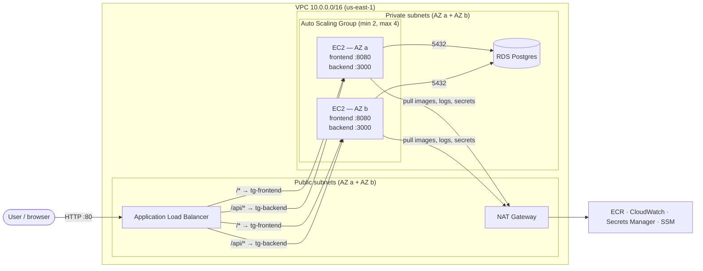
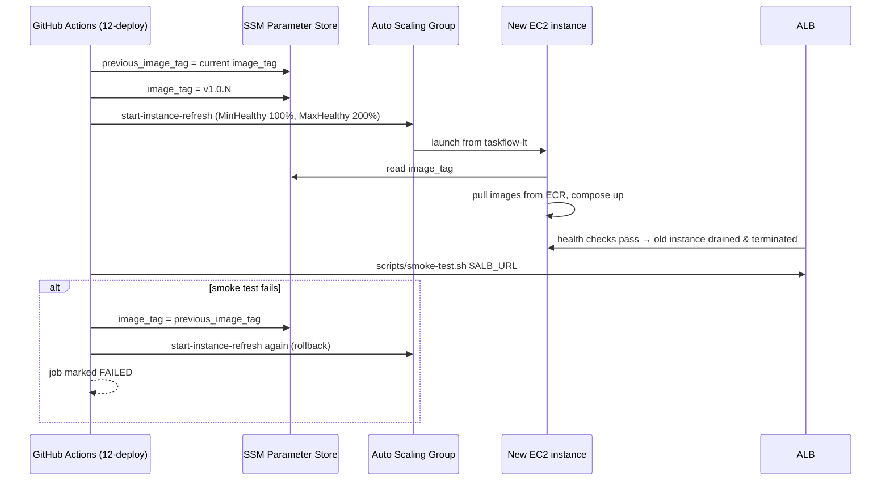

# Architecture

How TaskFlow is built, deployed and watched — and the **contracts** every member codes against.

> **Rule:** the names, ports, paths and variables in [§3 Contracts](#3-contracts-single-source-of-truth) are
> fixed. If you need to change one, open a PR that edits this file **first** and get a 👍 from every owner it
> affects. Most integration bugs in group projects come from two people guessing a name differently.

Contents: [1 Overview](#1-overview) · [2 Services](#2-services) · [3 Contracts](#3-contracts-single-source-of-truth) ·
[4 Network](#4-network-design) · [5 Pipeline](#5-pipeline) · [6 Deploy & rollback](#6-deployment-and-rollback) ·
[7 Security](#7-security-model) · [8 Observability](#8-observability) · [9 How we build](#9-how-we-build-it-tests-first)

---

## 1. Overview

**Request flow:** browser → ALB (public subnets) → path rule picks a target group → container on an EC2
instance in a private subnet → backend talks to RDS in the private subnets. Instances have no public IP and
reach AWS APIs/ECR through the NAT gateway.

**Delivery flow:** feature branch → PR → stages 2–10 must pass → review → merge → stage 11 pushes images to
ECR → stage 12 sets the new tag in SSM and runs an ASG instance refresh → smoke test → auto-rollback if it fails.

## 2. Services

| Service | Tech | Container port | Health endpoint | Owner (code / container) |
|---------|------|----------------|-----------------|--------------------------|
| `frontend` | Static HTML + vanilla JS (bundled with esbuild), served by **nginx-unprivileged** | **8080** | `GET /health` → `200 ok` | M1 / M2 |
| `backend` | **Node 24 + Express**, `pg` client | **3000** | `GET /api/health` → `200 {"status":"ok",...}` | M1 / M2 |
| `db` | **Postgres 17** (container locally, **RDS** on AWS) | 5432 | — | M1 (schema) / M4 (RDS) |

Why vanilla JS for the frontend: Jest works with zero extra config, small images, fewer Snyk/Trivy findings.
React is allowed if Member 1 wants it, but it costs time we don't have.

**How services find each other**
- **Locally (Compose):** all three on the Compose network `taskflow`. Frontend nginx proxies `/api/` →
  `http://backend:3000`. Backend connects to `db:5432`. The browser only ever talks to `localhost:8080`.
- **On AWS:** the **ALB** routes `/api/*` straight to the backend target group and everything else to the
  frontend target group. Backend connects to the RDS endpoint (from Secrets Manager). Same browser code works
  in both places because it always calls the relative path `/api/...`.

## 3. Contracts (single source of truth)

### 3.1 Naming
| Thing | Name |
|-------|------|
| Project prefix / AWS tag `Project` | `taskflow` |
| AWS region | `us-east-1` |
| ECR repositories | `taskflow-frontend`, `taskflow-backend` |
| Compose network | `taskflow` |
| Compose services | `frontend`, `backend`, `db` |

### 3.2 HTTP API (backend, all under `/api`)
| Method | Path | Body | Response |
|--------|------|------|----------|
| GET | `/api/health` | — | `200 {"status":"ok","service":"backend","version":"<APP_VERSION>"}` — **liveness only, must NOT query the DB** (otherwise an RDS blip makes the ASG kill every instance) |
| GET | `/api/tasks` | — | `200 [ {id, title, done, created_at} ]` |
| POST | `/api/tasks` | `{"title": "string 1–200 chars"}` | `201 {task}` · `400 {"error": "..."}` |
| PATCH | `/api/tasks/:id` | `{"title"?, "done"?}` | `200 {task}` · `404` |
| DELETE | `/api/tasks/:id` | — | `204` · `404` |

Errors always look like `{"error": "human readable message"}`.

### 3.3 Environment variables (backend)
| Var | Local value (compose) | AWS value comes from |
|-----|-----------------------|----------------------|
| `PORT` | `3000` | compose.prod |
| `APP_VERSION` | `dev` | image tag, e.g. `v1.0.42` |
| `DB_HOST` | `db` | Secrets Manager `taskflow/prod/db` → `host` |
| `DB_PORT` | `5432` | secret → `port` |
| `DB_NAME` | `taskflow` | secret → `dbname` |
| `DB_USER` | `taskflow` | secret → `username` |
| `DB_PASSWORD` | local-only dummy in `.env` (git-ignored) | secret → `password` |
| `LOG_LEVEL` | `debug` | `info` |

The backend creates its table on startup (`CREATE TABLE IF NOT EXISTS tasks ...`), so no separate migration tool.

### 3.4 Images & versions
- Root file **`VERSION`** holds `major.minor` (e.g. `1.0`). Bump it by PR for big changes.
- Each merge to main produces version **`v<VERSION>.<github.run_number>`**, e.g. `v1.0.42`.
- Every image is pushed with **two tags**: the full git SHA and the version. ECR tags are **immutable**, so a
  tag is never reused — that is why the patch number comes from the run number.
- Both services always ship with the **same version tag** (simpler rollback).

### 3.5 AWS resource names
| Resource | Name |
|----------|------|
| VPC | `taskflow-vpc` |
| Subnets | `taskflow-public-a`, `taskflow-public-b`, `taskflow-private-a`, `taskflow-private-b` |
| Security groups | `taskflow-alb-sg`, `taskflow-app-sg`, `taskflow-db-sg` |
| ALB | `taskflow-alb` |
| Target groups | `taskflow-tg-frontend` (port 8080, health `/health`), `taskflow-tg-backend` (port 3000, health `/api/health`) |
| Launch template | `taskflow-lt` |
| ASG | `taskflow-asg` |
| RDS instance | `taskflow-db` |
| Secret (Secrets Manager) | `taskflow/prod/db` |
| SSM parameter — current tag | `/taskflow/prod/image_tag` |
| SSM parameter — previous tag | `/taskflow/prod/previous_image_tag` |
| IAM role — CI (stage 11) | `taskflow-github-ci-role` |
| IAM role — deploy (stage 12 + rollback) | `taskflow-github-deploy-role` |
| IAM role — EC2 | `taskflow-ec2-role` (+ instance profile of same name) |
| Log groups | `/taskflow/frontend`, `/taskflow/backend` |
| SNS topic | `taskflow-alerts` |
| Dashboard | `taskflow-dashboard` |

### 3.6 GitHub Secrets / variables
| Name | Type | Used by |
|------|------|---------|
| `SONAR_TOKEN` | secret | stage 7 |
| `SNYK_TOKEN` | secret | stage 8 |
| `AWS_ACCOUNT_ID` | variable | stages 11–12, rollback |
| `AWS_REGION` | variable (`us-east-1`) | stages 11–12, rollback |
| `ALB_URL` | variable | smoke test |

**No AWS access keys in GitHub. Ever.** AWS access is only via OIDC roles.

## 4. Network design

| Subnet | CIDR | AZ | Route table | Contains |
|--------|------|----|-------------|----------|
| `taskflow-public-a` | `10.0.1.0/24` | us-east-1a | public: `0.0.0.0/0 → IGW` | ALB node, NAT gateway |
| `taskflow-public-b` | `10.0.2.0/24` | us-east-1b | public: `0.0.0.0/0 → IGW` | ALB node |
| `taskflow-private-a` | `10.0.11.0/24` | us-east-1a | private: `0.0.0.0/0 → NAT` | EC2 (ASG), RDS |
| `taskflow-private-b` | `10.0.12.0/24` | us-east-1b | private: `0.0.0.0/0 → NAT` | EC2 (ASG), RDS standby subnet |

- VPC `10.0.0.0/16` leaves room to grow; `/24` per subnet = 251 usable IPs, far more than we need.
- **One NAT gateway** (in AZ a) instead of one per AZ — saves ~$32/month. Trade-off: if AZ a dies, instances
  in AZ b can't pull new images until it's back (running containers keep serving). Documented and accepted
  for a student budget.
- RDS is **single-AZ** `db.t4g.micro` (free tier). Its subnet group still spans both private subnets.

**Security group rules (no other inbound rules exist)**
| SG | Inbound | From |
|----|---------|------|
| `taskflow-alb-sg` | TCP 80 | `0.0.0.0/0` |
| `taskflow-app-sg` | TCP 8080, TCP 3000 | **`taskflow-alb-sg` only** |
| `taskflow-db-sg` | TCP 5432 | **`taskflow-app-sg` only** |

**Port 22 is not open anywhere.** Shell access = SSM Session Manager.

## 5. Pipeline

One workflow file, `.github/workflows/pipeline.yml`. Jobs are chained with `needs:` so they run **in order**
and a failure stops everything after it. **Job names are fixed** — they become the required status checks.

```mermaid
flowchart LR
    s2[2-secret-scan] --> s3[3-lint] --> s4[4-format] --> s5[5-dockerfile-lint] --> s6[6-unit-tests]
    s6 --> s7[7-static-analysis] --> s8[8-dependency-scan] --> s9[9-build-image] --> s10[10-image-scan]
    s10 -->|main only| s11[11-push-image] --> s12[12-deploy]
    s12 -.->|smoke test fails| rb[auto-rollback]
```

| Job | Tool | Fails when | Owner |
|-----|------|-----------|-------|
| `2-secret-scan` | Gitleaks, `fetch-depth: 0` | any secret in full history | M3 |
| `3-lint` | ESLint (both services) + ShellCheck (`scripts/`, `infra/*.sh`) | any error | M3 |
| `4-format` | `prettier --check .` | any unformatted file | M3 |
| `5-dockerfile-lint` | Hadolint (both Dockerfiles) | any warning ≥ `warning` | M3 |
| `6-unit-tests` | Jest + coverage (uploads `lcov`) | failing test or coverage < 80% | M3 |
| `7-static-analysis` | SonarCloud, wait for quality gate | quality gate failed | M3 |
| `8-dependency-scan` | Snyk `--severity-threshold=high` | high/critical vuln | M3 |
| `9-build-image` | `docker build` both images, saved as artifacts | build fails | M3 |
| `10-image-scan` | Trivy `--severity HIGH,CRITICAL --exit-code 1` | high/critical vuln | M3 |
| `11-push-image` | OIDC → `taskflow-github-ci-role` → push to ECR | push fails | M2 |
| `12-deploy` | OIDC → `taskflow-github-deploy-role` → `scripts/deploy.sh` → `scripts/smoke-test.sh` | smoke test fails (after auto-rollback) | M2 |

- Stage 1 ("code commit") is the branch + PR itself, not a job.
- Jobs 11 and 12 run only on `push` to `main` (`if: github.event_name == 'push' && github.ref == 'refs/heads/main'`).
- Job 11 pushes **the exact images built and scanned in 9–10** (loaded from the artifact), not a rebuild.
- `.github/workflows/rollback.yml` — manual (`workflow_dispatch`) with input `image_tag`.

## 6. Deployment and rollback

- **Rolling:** `MinHealthyPercentage=100`, `MaxHealthyPercentage=200` → new instances come up *before* old
  ones are removed, so capacity never drops. `InstanceWarmup=120`.
- **What runs on an instance:** the launch template's user-data (`infra/user-data.sh`) installs Docker,
  logs in to ECR, reads the tag from SSM, reads the DB secret into a root-only env file, and runs
  `docker compose -f docker-compose.prod.yml up -d`.
- **Manual rollback:** run the *Rollback* workflow with an existing tag (e.g. `v1.0.40`). It checks the tag
  exists in ECR, then runs the same `deploy.sh` + `smoke-test.sh`.

## 7. Security model

**IAM roles (least privilege) — policy JSON lives in `infra/iam/`**
| Role | Trusted by | Can do |
|------|-----------|--------|
| `taskflow-github-ci-role` | GitHub OIDC, `repo:AmarWaqar-TSKLI/taskflow-devops:ref:refs/heads/main` only | ECR push to the two repos (`ecr:GetAuthorizationToken`, `BatchCheckLayerAvailability`, `InitiateLayerUpload`, `UploadLayerPart`, `CompleteLayerUpload`, `PutImage`, `BatchGetImage`) |
| `taskflow-github-deploy-role` | GitHub OIDC, main branch only | `ssm:GetParameter/PutParameter` on `/taskflow/prod/*`, `autoscaling:StartInstanceRefresh/DescribeInstanceRefreshes` on `taskflow-asg`, `ecr:DescribeImages` |
| `taskflow-ec2-role` | `ec2.amazonaws.com` | ECR pull, `ssm:GetParameter` on `/taskflow/prod/*`, `secretsmanager:GetSecretValue` on `taskflow/prod/db`, CloudWatch logs/metrics (`CloudWatchAgentServerPolicy`), `AmazonSSMManagedInstanceCore` (Session Manager) |

**Where secrets live**
| Secret | Stored in | Never in |
|--------|-----------|----------|
| DB password | AWS Secrets Manager `taskflow/prod/db` | repo, image, user-data, logs |
| Sonar / Snyk tokens | GitHub Secrets | repo |
| AWS access | OIDC short-lived tokens | anywhere — **no access keys exist** |
| Local dev DB password | `.env` (git-ignored); `.env.example` has a placeholder | repo |

Other controls: IMDSv2 required on the launch template · no key pair on instances · containers run as non-root
· ECR scan-on-push · Dependabot weekly PRs · branch protection with required checks.

## 8. Observability

| Need | How |
|------|-----|
| Centralized logs | `docker-compose.prod.yml` uses the **`awslogs` log driver** → `/taskflow/frontend`, `/taskflow/backend` (retention 7 days). Backend logs **one JSON line per request**: `{"level","msg","method","path","status","duration_ms"}` |
| Request rate | ALB `RequestCount` |
| Errors | ALB `HTTPCode_Target_5XX_Count`, `HTTPCode_ELB_5XX_Count` |
| Latency | ALB `TargetResponseTime` (p50/p95/p99) |
| CPU | EC2 `CPUUtilization` by `AutoScalingGroupName` |
| Memory | **CloudWatch agent** `mem_used_percent` (EC2 doesn't report memory by default) |
| Alarm 1 | `UnHealthyHostCount ≥ 1` on either target group for 2 min → SNS `taskflow-alerts` |
| Alarm 2 | backend 5xx > 10 in 1 min (2 consecutive periods) → SNS |
| Alarm 3 (optional) | ASG average CPU > 80% for 5 min → SNS |

## 9. How we build it: tests first

The full rules are in [CONTRIBUTING.md](../CONTRIBUTING.md). The short version:

1. **Test before code.** For every function/endpoint: write a failing Jest test → make it pass → clean up.
   A PR that adds logic without tests gets sent back.
2. **Coverage ≥ 80%** is enforced by Jest (`coverageThreshold`) *and* by the SonarCloud quality gate.
3. **Unit tests never need a real DB or AWS.** Backend code is split into `routes` → `service` → `repository`;
   tests mock the repository. Integration is checked by Compose + the smoke test.
4. **Contract first.** Code against §3. Need a new name/port/var? Edit this file in a PR first.
5. **Everything through a PR, everything green.** No direct pushes, no skipping scanners, no lowering thresholds.
6. **"Tested" means proven.** Ticking *Tested* in PROGRESS.md needs a link: green CI run, screenshot, or the
   command you ran and its output.
