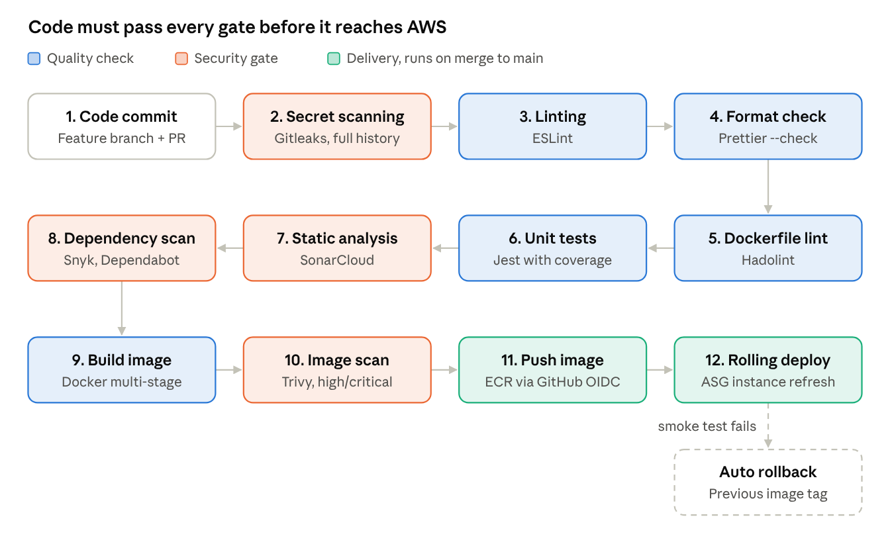

# Requirements — the full brief as a checklist

This is a faithful rewrite of [brief/project-brief.docx](brief/project-brief.docx). **Every
item is mandatory.** If something here and the .docx ever disagree, the .docx wins — tell the team.

- **Deadline:** Monday 30 November 2026 (the "4 weeks" in the brief does not apply to us).
- **Group:** 3–5 students (we are 5). One submission per group.
- **Theme:** our choice and kept small. Ours: **TaskFlow, a task tracker**.
- Graded on: automation, collaboration, security, observability, high availability, scalability.
- Marks can differ per member, based on the **contribution table** and the **viva**.

---

## 1. The required pipeline (12 stages, in this order)

| # | Stage | Tool | When |
|---|-------|------|------|
| 1 | Code commit | Feature branch + PR | every push & PR |
| 2 | Secret scanning | **Gitleaks, full history** | every push & PR |
| 3 | Linting | **ESLint** | every push & PR |
| 4 | Format check | **Prettier --check** | every push & PR |
| 5 | Dockerfile lint | **Hadolint** | every push & PR |
| 6 | Unit tests | **Jest with coverage** | every push & PR |
| 7 | Static analysis | **SonarCloud** | every push & PR |
| 8 | Dependency scan | **Snyk + Dependabot** | every push & PR |
| 9 | Build image | Docker multi-stage | every push & PR |
| 10 | Image scan | **Trivy, high/critical** | every push & PR |
| 11 | Push image | ECR via **GitHub OIDC** | every merge to main |
| 12 | Rolling deploy | **ASG instance refresh** | every merge to main |

- A failing stage **stops the pipeline and blocks the merge**.
- If the **smoke test after deploy fails → automatic rollback** to the previous image version.

## 2. Application & version control
- [ ] At least **two services** (frontend + backend API) **plus a database/storage layer**.
- [ ] **One GitHub repo** for everything.
- [ ] **Documented branching strategy** (main + feature branches).
- [ ] PRs need **at least one reviewer** from the group.
- [ ] **Protected main**: blocks direct pushes, **requires every CI check to pass** before merge.
- [ ] Commit history shows contributions from **every** member.

## 3. Shell scripting
- [ ] At least **two non-trivial** shell scripts automating real tasks (build/test, deploy, health check, backup…).
- [ ] Error handling: `set -euo pipefail` (or equivalent).
- [ ] Pass **ShellCheck**.
- [ ] Called from the pipeline **or** documented in the README.
- [ ] The **post-deploy smoke test (stage 12) is one of these scripts**.

## 4. Containerization
- [ ] A **Dockerfile for every service**: multi-stage, minimal base image with **pinned version (not `latest`)**, **non-root user**, **`.dockerignore`**.
- [ ] **Docker Compose** runs the whole stack locally with **one command**.
- [ ] The same Compose file (or a **production variant**) runs the stack on the cloud instances.
- [ ] Images pushed to **Amazon ECR** with **tag immutability enabled**.
- [ ] Each image tagged with the **git commit SHA** and a **semantic version** (e.g. `v1.3.0`) — not just `latest`.

## 5. High availability
- [ ] **≥ 2 Availability Zones**; VPC with **public and private subnets in each zone**.
- [ ] App runs on instances in **private subnets**, launched from a **launch template**.
- [ ] Behind an **Application Load Balancer** with health checks on **each service's health endpoint**.
- [ ] Console or CLI is fine, but **every config choice** (VPC, subnets, route tables, SGs, launch template, ASG, ALB) **documented in the README** so it can be rebuilt.
- [ ] **Failure demo:** terminate an instance while the app is in use → app stays available and recovers automatically.

## 6. Scalability
- [ ] **Auto Scaling Group** across ≥ 2 zones, **minimum 2 instances**.
- [ ] **Target tracking** policy on CPU **or** request count per target.
- [ ] **Load test** (k6 / ab / Locust) showing **scale-out under load and scale-in afterwards**.
- [ ] Evidence: **CloudWatch metrics** + **Auto Scaling activity history**.

## 7. Continuous integration
- [ ] GitHub Actions workflow on **every push and PR** implementing stages 1–10 **in order**.
- [ ] Gitleaks scans the **full history**.
- [ ] Jest unit tests produce a **coverage report**.
- [ ] **Each stage is a separate, visible job** and a **required status check on main**.

## 8. DevSecOps
- [ ] Security stages **fail the pipeline** on: any Gitleaks secret · failed SonarCloud quality gate · high/critical from Snyk or Trivy.
- [ ] **Dependabot enabled** alongside Snyk.
- [ ] Fix every finding **or** document it in **SECURITY.md** with a reason. **Disabling a scanner or lowering its threshold is NOT allowed.**
- [ ] **Least-privilege IAM** with **separate roles for CI, deployment, and EC2 instances**.
- [ ] Secrets out of the repo: **GitHub Secrets**, **OIDC to AWS**, **Secrets Manager or SSM Parameter Store**.
- [ ] **No long-lived AWS keys** in the pipeline.
- [ ] Instances accept traffic **only from the load balancer**.
- [ ] **SSH closed** — use **SSM Session Manager**.

## 9. Continuous delivery
- [ ] Every merge to main **automatically** builds, scans, pushes a versioned image to ECR and **deploys with no manual steps** (stages 11–12).
- [ ] Deployments are **rolling** — app stays available during updates.
- [ ] After each deploy, **smoke test against the load balancer**; **auto-rollback** to previous image if it fails.
- [ ] A **manual rollback workflow** taking an **image tag as input**.
- [ ] **Demo:** a change flowing from commit to the live app.
- [ ] **Demo:** a rollback to a previous image version.

## 10. Observability & troubleshooting
- [ ] Monitoring + logging with **Amazon CloudWatch** (Prometheus/Grafana optional).
- [ ] **Dashboard**: request rate, errors, latency, CPU, memory.
- [ ] **Centralized logs for every service**.
- [ ] **≥ 2 alarms** (e.g. high error rate, unhealthy targets) with **SNS notifications**.
- [ ] **One deliberate failure**: show alarm firing → diagnose with logs & metrics → fix → **short post-incident note**.

## 11. Networking & microservices
- [ ] Document & justify the network design: **CIDR ranges, public vs private subnets, NAT/gateways, security group rules, how services find each other** (Compose network, ALB path routing).
- [ ] Each service exposes a **health endpoint**.
- [ ] Each service is **independently buildable and deployable**.

## 12. Deployment
- [ ] App **running on AWS** with a **live link** (ALB or domain URL) **until grading is complete**.

## 13. Group rules
- [ ] Every member **owns visible parts** of the project.
- [ ] Every member has **commits, PRs, or reviews** in the repo.
- [ ] Every member can **explain and demo any part**, and **run a change through the pipeline live**, including **showing a security stage blocking a vulnerable change** (viva).

## 14. Cost & safety
- [ ] Resource usage as low as possible. **AWS Budget alert set.**
- [ ] Small instance types; scale down when not testing.
- [ ] **Do NOT delete the deployment until grading is complete.**
- [ ] **Never commit credentials** — a leaked secret anywhere in history = **deduction**.

## 15. README must explain
- [ ] How to **run the stack locally**.
- [ ] How to **deploy from scratch**.
- [ ] How to **tear everything down**.

---

## What we submit: one PDF named `GroupX.pdf`

- **Page 1:** all group members with roll numbers.
- **GitHub and live links must be clickable and working at grading time.**

### Part 1 — Architecture diagram
Must show: every AWS service and tool · the AZs and subnets · request flow internet → ALB → services → data
layer · all 12 pipeline stages delivering code to the instances (incl. **OIDC roles** and **where secrets are
stored**) · where monitoring & logging fit.

### Part 2 — Proof of deployment
GitHub repo link (instructor + TA must have access) with workflow files, Dockerfiles, Compose file, shell
scripts and SECURITY.md visible, plus screenshots of:

1. CI run with each stage as a separate job (secret scan, lint, format, Dockerfile lint, tests, static analysis, dependency scan, image build, image scan)
2. A run where a **security stage failed and blocked a PR**
3. **Branch protection** settings for main
4. **ECR** with tagged images
5. The **IAM OIDC trust policy**
6. The **multi-zone setup**
7. The **failure-recovery** demo
8. The **load test** with scale-out and scale-in
9. A commit **deployed automatically** and a **rollback**
10. The **monitoring dashboard** and a **fired alarm**

### Part 3 — Live link
URL of the deployed app.

### Part 4 — Short findings report (one page)
What we learned · main problems and how we solved them (incl. post-incident note in a few lines) · impact on
our understanding of DevOps, security, automation, reliability and cloud · **table of each member's name,
roll number and contributions**.
